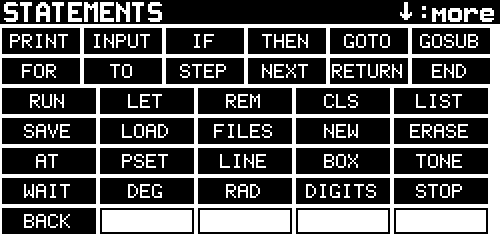

# PX-BASIC

The PX-42F calculator's BASIC, based on Tiny BASIC: an interpreter that runs
on the calculator as a native app. It follows Palo Alto Tiny BASIC (1976): numbered lines, `PRINT`, `INPUT`, `IF`,
`GOTO`, `GOSUB`, `FOR`/`NEXT`. Its numbers are the calculator's own:
34-digit decimals from the decimal library Plus42 computes with, so
`0.1+0.2` is exactly `0.3` and `SIN` has the calculator's precision. It
also adds the PX-42F's screen, keys, speaker and drive.

**[`basic_manual.html`](basic_manual.html) is the full manual:** the keyboard in both modes,
every statement and function, graphics, files, errors and the examples. Open
it in a browser.

It's built on the PX-42F App Template. The framework's files, `px42f/` and
`sim/`, come from there, and so does its manual.

## Install

1. Build it with `make`, or the VS Code Build task. It needs the PX-42F-Plus
   firmware with app API version 3.
2. Copy it to the calculator: Settings → USB Drive → Connect to Computer, then
   `make install`. That puts `BASIC.bin` in `BIN/APPS`.
3. Optionally, copy the examples from `sim/drive/BIN/APPS/BASIC/` to
   `BIN/APPS/BASIC/` on the drive.
4. On the calculator: Settings → Games & Apps → Apps → BASIC.

The prompt is `>`. Type a line with a number and it goes into the program;
type one without and it runs at once. ON at the prompt asks `LEAVE BASIC?
ENTER=YES` before leaving; held 2 s, it turns the calculator off. The program in memory when you leave is saved as
`AUTOSAVE.BAS` and comes back the next time, whatever you `SAVE`d or `LOAD`ed under other names
(not written if the calculator crashes or is reset).

## Typing

The keys type in two modes, shown at the top right of the screen:

| Mode | The keys type |
|---|---|
| **ALPHA** (each line typed at the prompt starts in it) | the letters where the calculator's ALPHA keyboard has them (A–F on the top row, G–L on the second, M N O next to ENTER, then P–Z), `=` after Z, `: . ? space` on the bottom row |
| **NUM** (a program's `INPUT` starts in it) | digits and `+ - * /` where they're printed, `.` and space on the bottom row; above them `( ) " , ; :` (top row), `< > = @ ' ?` (second row), `^ # E` (next to ENTER) |

| Key | Does |
|---|---|
| SHIFT ENTER | ALPHA (printed below ENTER): switches between ALPHA and NUM |
| SHIFT | with any other key: types the other mode's character, once |
| ▲ ▼ | on an empty line: the program editor. The list: ▲ ▼ move the highlight (SHIFT: a screenful), ENTER edits the line where it is (the header says EDIT), EXIT leaves. Editing: ▲ ▼ move the cursor, ENTER accepts, EXIT discards; either way you're back at the list. On a line with text at the prompt: ▲ ▼ move the cursor. |
| SHIFT ▲ | the history: the last line typed at the prompt; again, the one before (the last 8) |
| SHIFT ▼ | the keyword map (above): press a key to type its keyword. ▼ again shows the functions; ▼ once more, or a key with no keyword, goes back. |
| ← | deletes the character before the cursor; SHIFT ← the whole line |
| ENTER | enters the line |
| R/S | stops a running program, or an `INPUT` |
| SHIFT R/S | `RUN`: runs the program, in place of whatever is typed. The keyword map has `RUN` on R/S's place too |
| ON | stops a running program or an `INPUT`, like R/S; at the prompt, asks before leaving BASIC (ENTER or ON again: yes) |

**From a computer.** With the calculator on USB, open its console
("PX-42F Console", any terminal program at any speed). Type there, or paste a
whole program. Everything shown on the screen also goes to the terminal.
Ctrl-C stops a program, or clears the line at the prompt. The arrow keys, Home,
End and Delete work as in any shell: ← → move in the line, ↑ ↓ step through the
history (Ctrl-A, Ctrl-E, Ctrl-B, Ctrl-F, Ctrl-P, Ctrl-N and Ctrl-U do the same).
If the terminal never sends them, switch it to raw mode (CoolTerm: Connection →
Options → Terminal → Raw Mode).

## The language

**Numbers** have 34 significant digits. `PRINT` shows them rounded to 12
(`DIGITS n` changes that, 1–34), with `E` for very large or small ones:
`1.5E-7`. There are 26 variables, `A` to `Z`, and one array, `@(0)` to
`@(1023)`. Strings appear only in `PRINT` and as `INPUT`'s prompt.
Lowercase is fine; it becomes uppercase, except inside quotes.

### Statements

| Statement | Does |
|---|---|
| `PRINT a, b; "text"` (or `?`) | `,` moves to the next column of 8, `;` stays put; a `,` or `;` at the end keeps the line open |
| `INPUT "prompt", A, B` | asks for numbers; without a prompt it shows `A? ` |
| `LET A = 3` (or just `A = 3`) | `@(I) = 3` for the array |
| `IF c THEN statement` / `IF c THEN 100` | if `c` is false, the rest of the line is skipped |
| `GOTO n`, `GOSUB n`, `RETURN` | `n` can be an expression |
| `FOR I = a TO b STEP s` … `NEXT I` | `STEP` can be a fraction or negative |
| `END`, `STOP` | end the program |
| `REM text` | a note |
| `:` | separates statements on a line |
| `CLS` | clears the screen |
| `AT col, row` | moves the text cursor (0–30, 0–8) |
| `PSET x, y, c` | a pixel: `c` 1 black (the default), 0 white |
| `LINE x1, y1, x2, y2, c` | a line |
| `BOX x, y, w, h, c` | a filled rectangle |
| `TONE n` | the calculator's tone 0–9, or 10 (the error sound) |
| `WAIT ms` | pauses; R/S stops it |
| `DEG`, `RAD` | angles in degrees or radians (the default). `RUN` starts in radians, so a program that wants degrees says `DEG` itself |
| `DIGITS n` | significant digits `PRINT` shows (12 at `RUN`) |

The screen is 250 × 122 pixels, with `(0, 0)` at the top left. The text uses 9
lines of 31 characters under the status bar.

### Expressions

| | |
|---|---|
| Operators, highest first | `^` (power, right to left) · `-` (minus) · `* / MOD` · `+ -` · `= <> < > <= >=` · `NOT` · `AND` · `OR` |
| Comparisons and logic | give 1 (true) or 0 (false); any value but 0 is true |
| `MOD` | `a MOD b` has the sign of `b`, as on the HP-42S: `-7 MOD 3` is 2 |
| Functions | `SIN COS TAN ASN ACS ATN` · `SQR EXP LOG LOG10` · `ABS SGN INT` (`INT` rounds down) · `RND(n)`: a whole number 1–`n`; `RND(0)`: a fraction 0–1 · `PI` |
| From the PX-42F | `KEY()`: the keys pressed during the run, one at a time in the order they were pressed, by place: 11 is the top-left key, 75 the + key; 0 when there are none. `SIZE`: bytes left for the program. |

### Commands

| Command | Does |
|---|---|
| `RUN` | runs the program from its first line (variables cleared) |
| `LIST`, `LIST 100`, `LIST 100,200` | shows the program: all of it, from 100, or 100 to 200 |
| `NEW` | erases the program |
| `SAVE "NAME"`, `LOAD "NAME"` | `NAME.BAS` in `/BIN/APPS/BASIC/` on the drive, plain text |
| `FILES` | lists the saved programs |
| `ERASE "NAME"` | deletes one |

Names are up to 20 letters, digits, `_` or `-`, with or without the quotes
(`LOAD RINGS3D`); lower case is the same name in
capitals (`"Ring_3d"` is `RING_3D`). A `.BAS` file is the
program as `LIST` shows it, so you can also write one on a computer.

### Errors

| Message | Means |
|---|---|
| `WHAT?` | it can't be read: a misspelling, a missing `)` |
| `HOW?` | it can't be done: division by zero, `SQR(-1)`, a line that isn't there, `RETURN` without `GOSUB` |
| `SORRY` | no room: the program is full (16 KB), or loops nest too deep |
| `BREAK` | R/S, ON or Ctrl-C stopped it |

In a program each message says where: `HOW? IN 120`.

## Examples

`sim/drive/BIN/APPS/BASIC/` has five:
- `HELLO`: a first program;
- `PRIMES`: the primes below 100;
- `GUESS`: guess a number, with `INPUT` and `RND`;
- `SPIRAL`: lines and trigonometry;
- `SINE`: two curves plotted with `PSET`.

## Building and testing

| Task | Command | Does |
|---|---|---|
| Build | `make` | `build/BASIC.bin` |
| Test | `make test` | `tests/test_basic.c` runs programs through the interpreter on your computer and checks what they print: arithmetic, formatting, control flow, errors, `INPUT`, files, the full program, R/S. Then `tests/ui_test.sh` runs scripted keys and terminal input through the simulator and checks what the editor and console print: editing, deleting, discarding, history, cursor keys, Ctrl-C, CR LF |
| Simulate | `make sim` | types a session on the simulated USB console and keys; screenshots in `build/sim-out` |
| Install on the PX-42F | `make install` | copies `BASIC.bin` to the calculator's drive |

The simulator and the tests use the computer's binary `double` for the
numbers, with about 16 digits. The calculator's are 34-digit decimals, so a
result can differ in the last digits; printed at 12 digits, they agree.

| File | What it is |
|---|---|
| `src/basic.c`, `basic.h` | the interpreter: the program store, expressions, statements, files; no hardware |
| `src/bio.h` | what the interpreter needs from the machine |
| `src/console.c`, `console.h` | the screen as a terminal, the two keyboard modes, the keyword map, the USB console |
| `src/main.c` | the prompt, `AUTOSAVE`, and `bio.h` on the PX-42F |
| `tools/shots.sh` | takes every screenshot the manual uses, in `build/shots`, then builds the manual and the keyword picture |
| `tools/make_manual.py`, `manual.css` | build `basic_manual.html`; the keyboard maps come from `src/console.c` |
